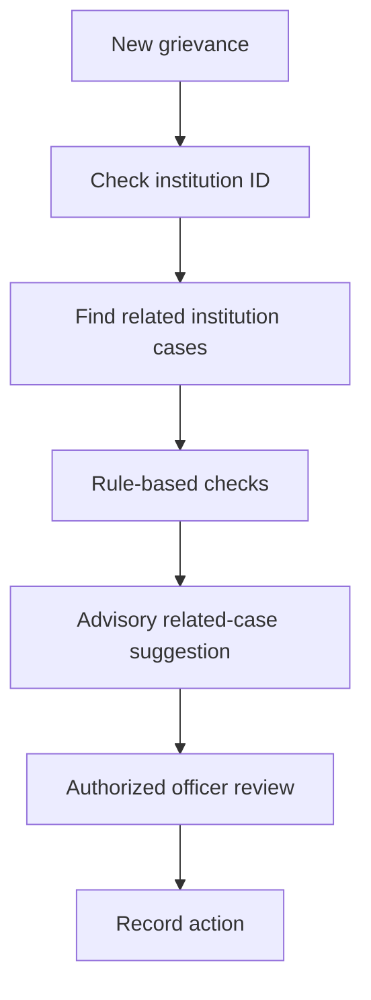
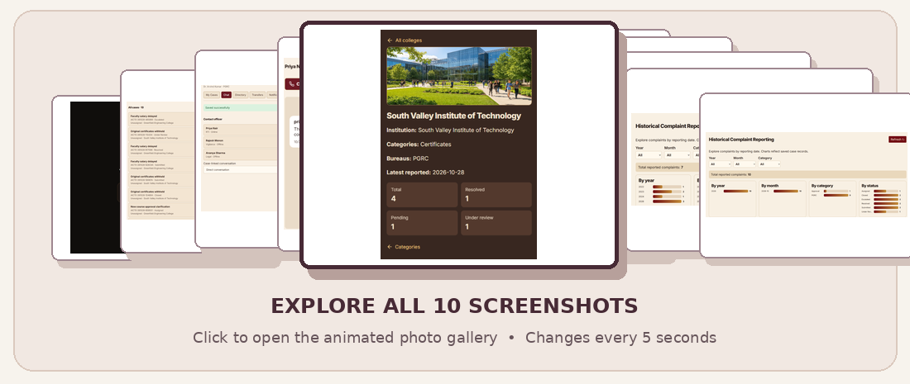

<h1>Integrated Institutional Grievance Intelligence, Monitoring and Cross-Bureau Coordination System</h1>

<strong>Smart India Hackathon 2026 · AICTE · Prototype</strong>

<em>One institution. One connected grievance history. Better-informed coordination.</em>

## ✦ The idea

Institutional complaints are often easier to understand **together** than as isolated tickets. This proposed platform connects student grievances, institution identities, officer assignments, and bureau workflows in one institution-centric workspace.

Complaints can be linked using an **AICTE Permanent ID**; official verification is a planned integration. Officers can explore complaint history, inspect potential duplicates, and review advisory coordination alerts across the **Regulation Bureau (RB)** and **Public Grievance Redressal Cell (PGRC)**.

> **Project scope:** Educational SIH prototype, not an official AICTE service. AI suggestions require officer review and do not automatically merge, escalate, or resolve cases.

## ✦ At a glance

| Institution intelligence | Cross-bureau coordination | Human-in-the-loop AI |
|:---|:---|:---|
| One institution profile links cases, statuses, and officers. | Potential RB–PGRC overlap alerts highlight coordination needs. | Advisory category and related-case suggestions support officer review. |

## ✦ Interactive architecture & application gallery

<b>Architecture explanation</b>

<ol>
<li><strong>Users:</strong> Students, officers, institutions, and administrators.</li>
<li><strong>Frontend:</strong> React + Vite for forms, dashboards, case views, and graphs.</li>
<li><strong>Backend:</strong> Python + FastAPI for endpoints and workflows.</li>
<li><strong>Intelligence &amp; data:</strong> SQLite and rule-based complaint checks; SBERT and TF-IDF are proposed enhancements.</li>
<li><strong>Outputs:</strong> Officer workspace, institution profiles, relationship graphs, reports, and alerts.</li>
</ol>

## ✦ Platform modules

<b>01 — Student grievance portal</b>

Students select an institution, submit grievance details, and track case status.

<b>02 — Officer dashboard & case workspace</b>

Authorized officers inspect cases, assignments, remarks, status changes, and action history.

<b>03 — Institution intelligence profile</b>

Institution records connect complaint history, categories, bureau assignments, and officers.

<b>04 — RB–PGRC coordination alerts</b>

Potentially overlapping active cases can be flagged for authorized officer review.

<b>05 — Relationship graph & reporting</b>

Visual relationships link institutions, complaints, bureaus, and officers; reporting summarizes case history.

## ✦ AI-assisted intelligence

Current prototype screenshots show **rule-based category suggestions** and **potential duplicate detection**. The following NLP methods are **proposed enhancements**, not verified deployed models.

| Model / method | Intended role |
|:---|:---|
| Sentence-BERT (`all-MiniLM-L6-v2`) | Semantic complaint embeddings |
| TF-IDF | Keyword similarity baseline |
| Cosine similarity | Similarity scoring |
| Python rules | Institution, status, and bureau overlap checks |
| SLA rules | Deadline monitoring |

## ✦ Technology stack

| Layer | Technology | Purpose |
|:---|:---|:---|
| Frontend | React + Vite | Interactive web interface |
| Backend | Python + FastAPI | REST endpoints and workflows |
| Database | SQLite | Prototype records |
| Current intelligence | Python rules | Advisory category and case checks |
| Proposed NLP | Sentence Transformers, scikit-learn | Semantic and keyword similarity |
| Access | Role-based permissions | Authorized workflows |

## ✦ Demo journeys

**Complaint to officer review:** Student submits a grievance → case is stored → related-case checks run → officer reviews and records actions.

**Potential cross-bureau overlap:** Related RB and PGRC complaints → advisory flag → officer verification → documented coordination decision.

## ✦ Application screenshots

## ✦ Responsible use

Student grievances may contain sensitive personal information. Do not commit real complaints, credentials, or private institution records to a public repository. Use synthetic records and enforce permissions on the backend. AI suggestions are advisory and require human review.

---

<strong>AICTE GRIEVANCE INTELLIGENCE SYSTEM</strong>

<em>Institutional visibility · Connected workflows · Responsible AI</em>

Smart India Hackathon 2026 · Educational prototype · Not affiliated with or endorsed by AICTE

