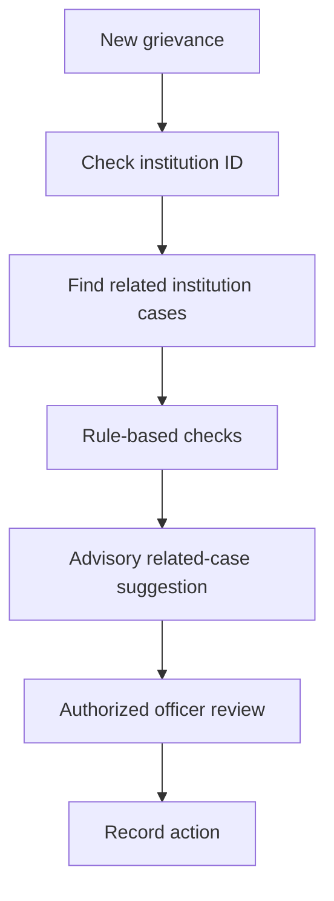

Integrated Institutional Grievance Intelligence, Monitoring and Cross-Bureau Coordination System
Smart India Hackathon 2026 · AICTE · Prototype

One institution. One connected grievance history. Better-informed coordination.

✦ The idea
Institutional complaints are often easier to understand together than as isolated tickets. This proposed platform connects student grievances, institution identities, officer assignments, and bureau workflows in one institution-centric workspace.

Complaints can be linked using an AICTE Permanent ID; official verification is a planned integration. Officers can explore complaint history, inspect potential duplicates, and review advisory coordination alerts across the Regulation Bureau (RB) and Public Grievance Redressal Cell (PGRC).
Project scope: Educational SIH prototype, not an official AICTE service. AI suggestions require officer review and do not automatically merge, escalate, or resolve cases.

✦ At a glance
Institution intelligence	Cross-bureau coordination	Human-in-the-loop AI
One institution profile links cases, statuses, and officers.	Potential RB–PGRC overlap alerts highlight coordination needs.	Advisory category and related-case suggestions support officer review.

✦ System architecture

Open interactive technology architecture

The live link requires GitHub Settings → Pages → Deploy from a branch → main → /docs and an actual docs/index.html file committed to the main branch. You can also [view the HTML source](docs/index.html). GitHub README pages cannot execute interactive JavaScript.

<b>Architecture explanation</b>

1. Users: Students, officers, institutions, and administrators.
2. Frontend: React + Vite for forms, dashboards, case views, and graphs.
3. Backend: Python + FastAPI for endpoints and workflows.
4. Intelligence & data: SQLite and rule-based complaint checks; SBERT and TF-IDF are proposed enhancements.
5. Outputs: Officer workspace, institution profiles, relationship graphs, reports, and alerts.

✦ Platform modules

<b>01 — Student grievance portal</b>

Students select an institution, submit grievance details, and track case status.

<b>02 — Officer dashboard & case workspace</b>

Authorized officers inspect cases, assignments, remarks, status changes, and action history.

<b>03 — Institution intelligence profile</b>

Institution records connect complaint history, categories, bureau assignments, and officers.

<b>04 — RB–PGRC coordination alerts</b>

Potentially overlapping active cases can be flagged for authorized officer review.

<b>05 — Relationship graph & reporting</b>

Visual relationships link institutions, complaints, bureaus, and officers; reporting summarizes case history.

✦ AI-assisted intelligence
Current prototype screenshots show rule-based category suggestions and potential duplicate detection. The following NLP methods are proposed enhancements, not verified deployed models.
Model / method	Intended role
Sentence-BERT (all-MiniLM-L6-v2)	Semantic complaint embeddings
TF-IDF	Keyword similarity baseline
Cosine similarity	Similarity scoring
Python rules	Institution, status, and bureau overlap checks
SLA rules	Deadline monitoring

✦ Technology stack
Layer	Technology	Purpose
Frontend	React + Vite	Interactive web interface
Backend	Python + FastAPI	REST endpoints and workflows
Database	SQLite	Prototype records
Current intelligence	Python rules	Advisory category and case checks
Proposed NLP	Sentence Transformers, scikit-learn	Semantic and keyword similarity
Access	Role-based permissions	Authorized workflows

✦ Demo journeys
Complaint to officer review: Student submits a grievance → case is stored → related-case checks run → officer reviews and records actions.

Potential cross-bureau overlap: Related RB and PGRC complaints → advisory flag → officer verification → documented coordination decision.
✦ Application screenshots
These screenshots show illustrative prototype records. Images are displayed at 440 px wide while retaining their natural aspect ratio. Original PNG files are not resized, cropped, or compressed.
Complaint submission

Officer workspace and case assignment

Officer communication

File attachments

Institution intelligence profile

Complaint relationship network

AI-assisted case intelligence

Historical complaint reporting

✦ Repository layout
The structure below shows the documentation assets and interactive HTML page. Application source folders should be added only when they exist in the repository.
repository/
├── README.md
├── assets/
│   ├── banner.png
│   ├── system-architecture.png
│   └── screenshots/
│       ├── ai-case-intelligence.png
│       ├── case-submission.png
│       ├── historical-reporting.png
│       ├── historical-reporting-status.png
│       ├── institution-profile.png
│       ├── officer-case-assignment.png
│       ├── officer-chat.png
│       ├── officer-chat-attachment.png
│       ├── relationship-graph-case.png
│       └── relationship-graph-institution.png
└── docs/
    └── index.html
Note: This tree shows the documentation files. The application source may also include frontend/ and backend/; add those folders to the diagram only after confirming their contents in GitHub.

✦ Details
Item	Details
Team	CYBRIXX
Hackathon	Smart India Hackathon 2026
Problem statement	SIH26264
Interactive architecture source	[index.html](docs/index.html)
Live interactive architecture	Open GitHub Pages
Repository	GitHub

✦ Responsible use
Student grievances may contain sensitive personal information. Do not commit real complaints, credentials, or private institution records to a public repository. Use synthetic records and enforce permissions on the backend. AI suggestions are advisory and require human review.

AICTE GRIEVANCE INTELLIGENCE SYSTEM

Institutional visibility · Connected workflows · Responsible AI

Smart India Hackathon 2026 · Educational prototype · Not affiliated with or endorsed by AICTE

