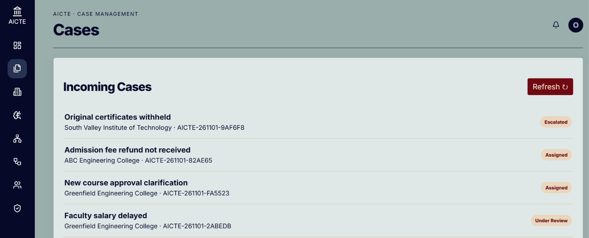
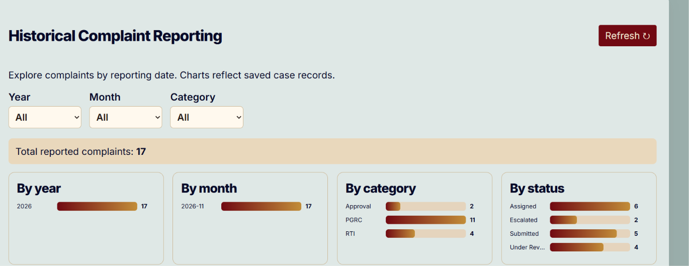
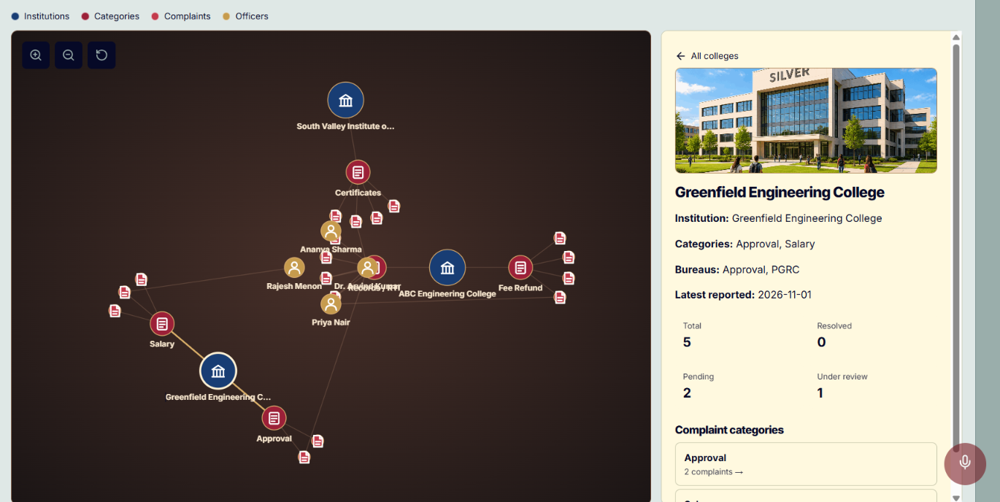
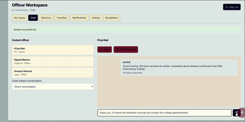
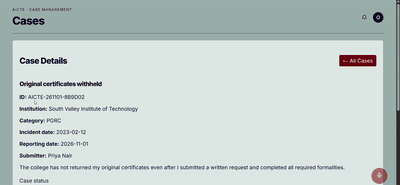
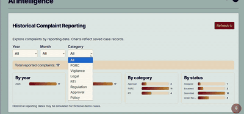
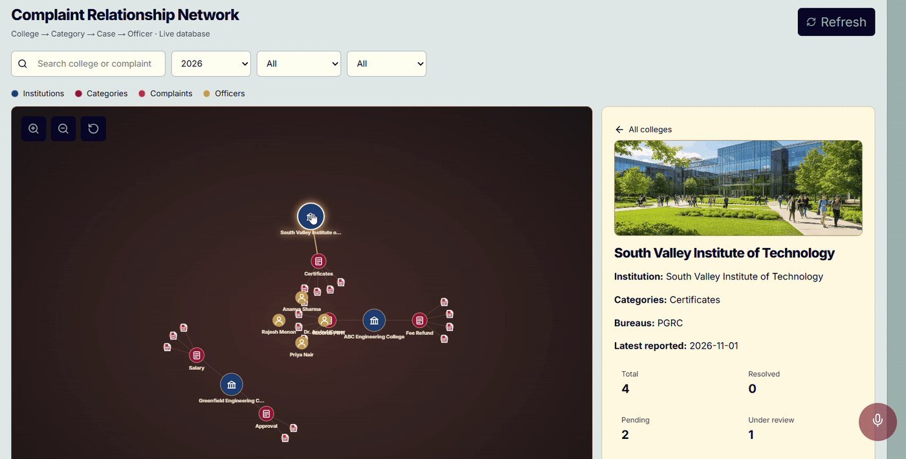
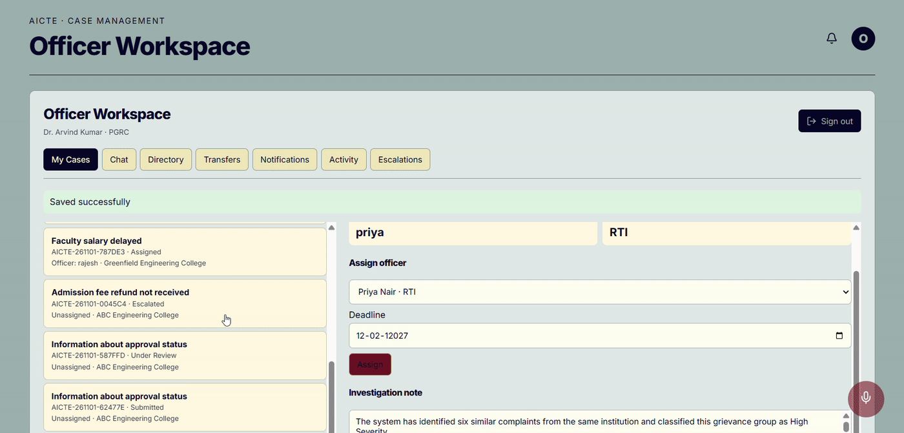
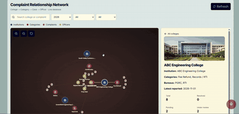

# AICTE Integrated Institutional Grievance Intelligence, Monitoring & Cross-Bureau Coordination System

**Smart India Hackathon 2026 · Educational Prototype · React · Vite · Python · FastAPI · SQLite · ML (planned)**

> This README uses a Radiant-inspired serif style in rendered section images. A fully searchable text version is in [docs/README_TEXT_ACCESSIBLE.md](docs/README_TEXT_ACCESSIBLE.md). The actual Radiant font is not included.

## Overview

## Problem and Solution

## Key Features

## Updated Interface Screenshots

## Animated Features

## Connected Case Intelligence Graph

## Planned AI Severity Alert

## Officer Case Management and Chat

## Historical Complaint Reporting

## Technology Stack

## Architecture

## Grievance Workflow

## Installation and Local Setup

## Interface Theme

## Future Enhancements

## Project Purpose

---

**Accessible text:** [Read or copy the complete Markdown README](docs/README_TEXT_ACCESSIBLE.md).

**Note:** GitHub does not support custom fonts for regular README text. The styled sections above are images; this package does not contain or distribute any font file.
