<div align="center">

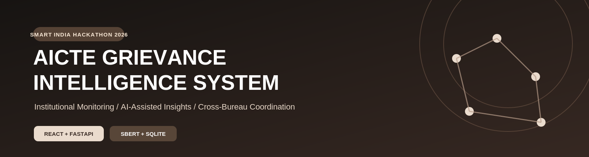

<br/>

### Integrated Institutional Grievance Intelligence, Monitoring and Cross-Bureau Coordination System

**Smart India Hackathon 2026 · AICTE · Prototype**

*One institution. One connected grievance history. Better-informed coordination.*


</div>

---

## ✦ The idea

Institutional complaints are often easier to understand **together** than as isolated tickets. Our proposed platform brings student grievances, verified institution identities, officer assignments, and bureau workflows into one institution-centric workspace.

Every complaint links to an institution using its **AICTE Permanent ID**. Officers can explore the full complaint history, inspect potential duplicates, and receive advisory coordination alerts when related active cases may span the **Regulation Bureau (RB)** and **Public Grievance Redressal Cell (PGRC)**.

> **Project scope:** An educational SIH prototype—not an official AICTE service. AI suggestions are reviewed by authorized officers; they do not automatically merge, escalate, or resolve cases.

## ✦ At a glance

| Institution intelligence | Cross-bureau coordination | Human-in-the-loop AI |
|:---|:---|:---|
| One institution profile connects related cases, statuses, and officers. | Potential RB–PGRC overlap alerts help officers identify coordination needs. | SBERT-based similarity suggestions support—not replace—officer review. |

## ✦ System architecture

<div align="center">

<a href="https://YOUR_USERNAME.github.io/YOUR_REPOSITORY/">
  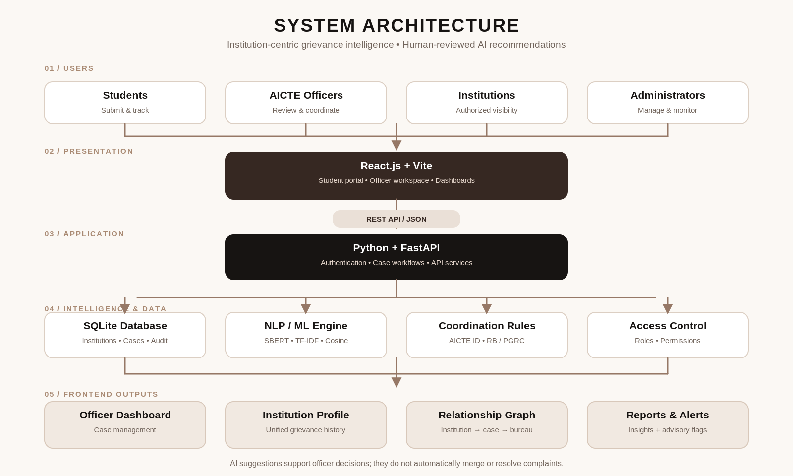
</a>

<br/>

<a href="https://YOUR_USERNAME.github.io/YOUR_REPOSITORY/">
  
</a>

<br/>
<sub>Click the diagram or badge to explore the live HTML architecture, technology, features, purpose, and workflows.</sub>

</div>

> **Before publishing:** Replace `YOUR_USERNAME` and `YOUR_REPOSITORY` in the two links above and the banner navigation with your GitHub details. GitHub README pages cannot execute JavaScript directly; the interactive HTML opens via GitHub Pages. You can also [view the HTML source](docs/index.html).

<details>
<summary><b>Open the architecture explanation</b></summary>

**01 · Users** — Students submit and track complaints; officers review cases; institutions and administrators access permitted views.

**02 · Frontend** — React + Vite renders portals, dashboards, case pages, visualizations, and alerts.

**03 · Backend** — FastAPI provides REST endpoints, validation, case workflows, and controlled data access.

**04 · Intelligence & data** — SQLite stores structured records. Sentence Transformers, TF-IDF, and cosine similarity provide complaint-matching signals. Python rules examine verified institution IDs and bureau assignments.

**05 · Outputs** — Officer dashboards, institution profiles, relationship graphs, reports, and alerts appear in the React application.

</details>

## ✦ Platform modules

<details open>
<summary><b>01 — Student grievance portal</b></summary>

Students select an institution, submit complaint details, and follow status changes. Each submission is associated with an institution record for consistent tracking.

</details>

<details>
<summary><b>02 — Officer dashboard & case workspace</b></summary>

Authorized officers review assigned grievances, inspect related cases, add remarks, update statuses, transfer or escalate work, and maintain a chronological action trail.

</details>

<details>
<summary><b>03 — Institution intelligence profile</b></summary>

A verified **AICTE Permanent ID** anchors institution metadata, complaint history, categories, bureau assignments, officers, and case status summaries.

</details>

<details>
<summary><b>04 — RB–PGRC coordination alerts</b></summary>

Potentially related active cases involving the same institution across bureaus are flagged as **“Potential Overlapping Cases – Coordination Required.”** Authorized officers inspect the evidence and decide next steps.

</details>

<details>
<summary><b>05 — Relationship graph & reporting</b></summary>

A visual network links **Institution → Complaint → Bureau → Officer**. Reporting views summarize case volumes, statuses, categories, regions, and deadlines.

</details>

## ✦ AI-assisted intelligence

The suggested model stack is **free and locally runnable** for a hackathon-scale prototype. These model choices are proposed architecture components; verify actual implementation before describing them as deployed.

| Model / method | Role in grievance intelligence |
|:---|:---|
| **Sentence-BERT** · `all-MiniLM-L6-v2` | Create semantic complaint embeddings |
| **TF-IDF** | Provide a keyword-based similarity baseline |
| **Cosine similarity** | Score similarity between complaint representations |
| **Python rules** | Check institution IDs, active-case status, and RB–PGRC overlaps |
| **SLA rules** | Identify approaching or overdue case deadlines |

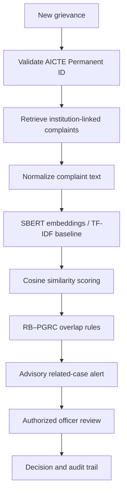

**Example:** “The college has not returned my admission fee” and “I am waiting for my refund after cancelling admission” may be semantically related even though the wording differs. A suggested match is **not** an official duplicate decision.

## ✦ Technology stack

| Layer | Technology | Why it fits |
|:---|:---|:---|
| Interface | React.js + Vite | Responsive, component-based frontend |
| API & workflows | Python + FastAPI | Typed REST endpoints and case logic |
| Prototype storage | SQLite | Simple relational institution/case records |
| NLP | Sentence Transformers | Local semantic embeddings |
| Text baseline | Scikit-learn | TF-IDF and cosine similarity |
| Coordination | Python rules | Transparent institution/bureau checks |
| Authorization | Role-based access control | Access based on authorized responsibilities |

## ✦ Demo journeys

<details>
<summary><b>Journey A — Complaint to officer review</b></summary>

1. Student selects the institution and submits a grievance.
2. FastAPI validates the submission and institution reference.
3. SQLite stores the complaint and its institution relationship.
4. NLP and rule checks generate advisory signals.
5. An authorized officer reviews the case and records actions.

</details>

<details>
<summary><b>Journey B — Potential cross-bureau overlap</b></summary>

1. An active RB complaint and an active PGRC complaint reference the same institution.
2. Similarity analysis identifies a possible relationship.
3. Coordination rules produce a **potential overlap** flag.
4. Officers inspect both records; no automatic case merging occurs.
5. Any coordination action is recorded in the case history.

</details>

## ✦ Application gallery
## ✦ Application Screenshots

Explore the implemented interface and core grievance-management workflows.

### Complaint Submission
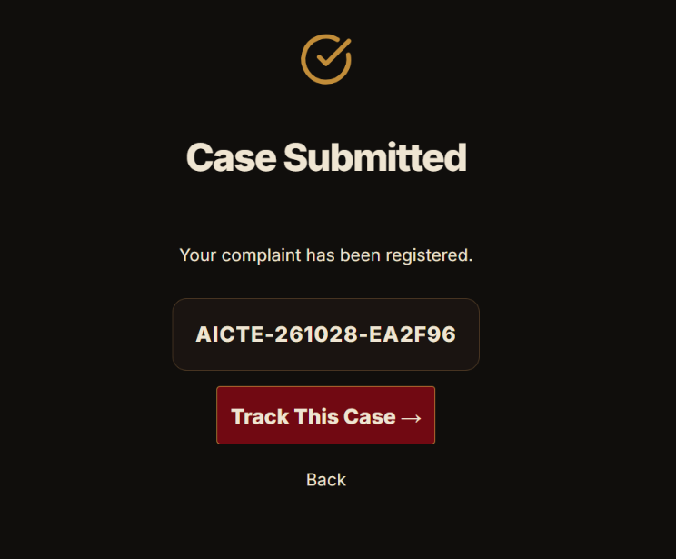

### Officer Workspace and Case Assignment
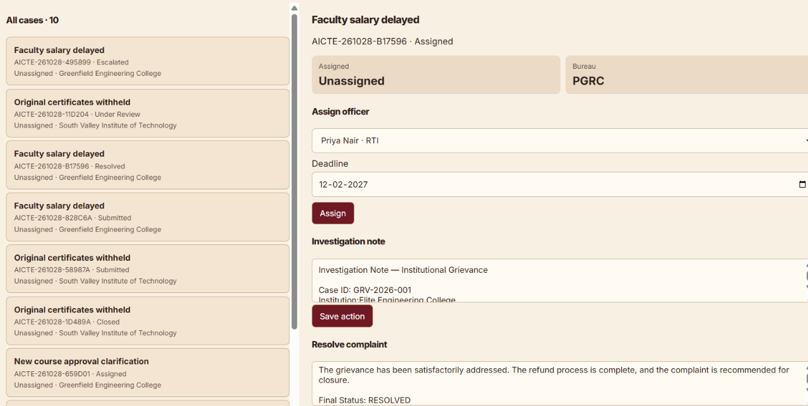

### Officer Communication
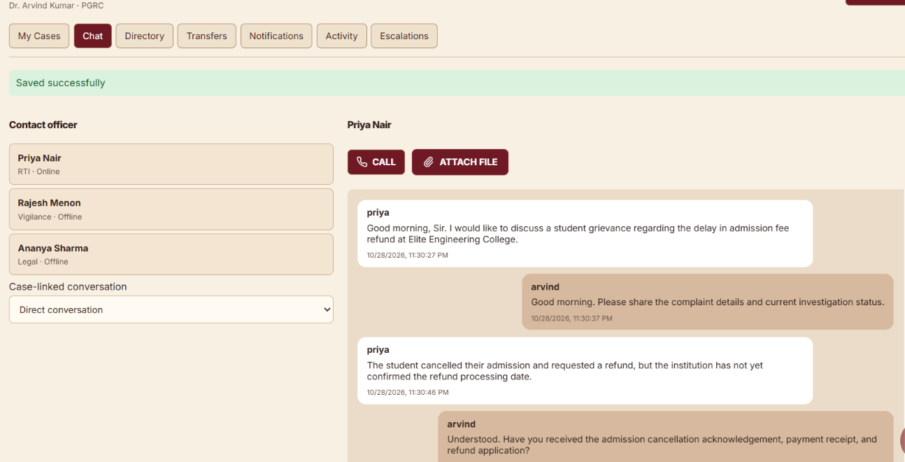

### File Attachments
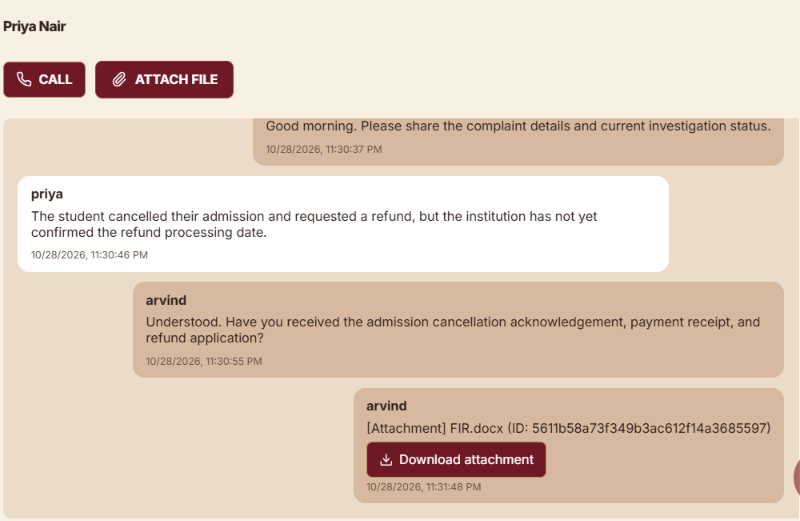

### Institution Intelligence Profile
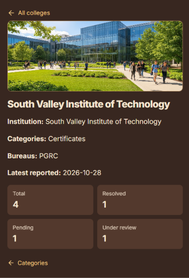

### Complaint Relationship Network
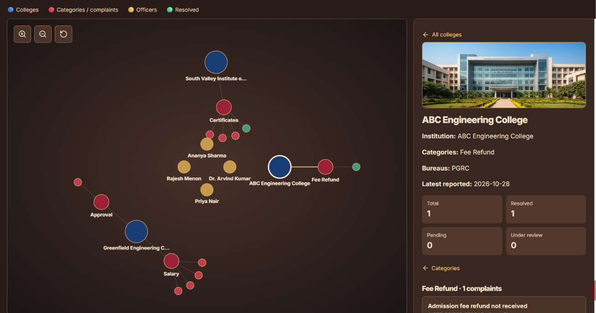

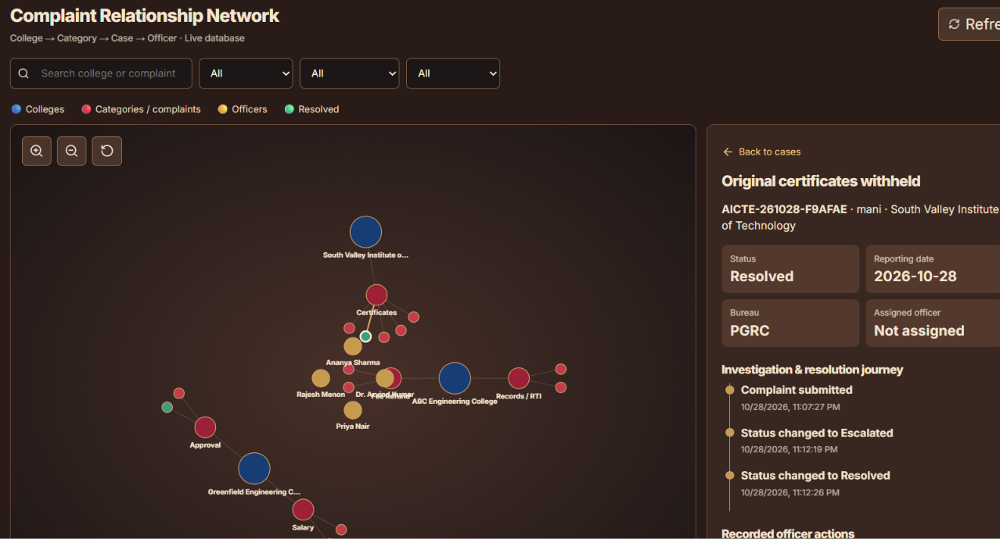

### AI-Assisted Case Intelligence
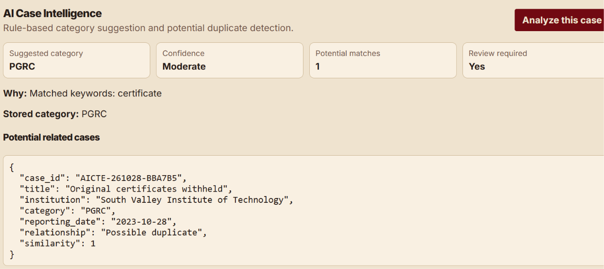

### Historical Complaint Reporting
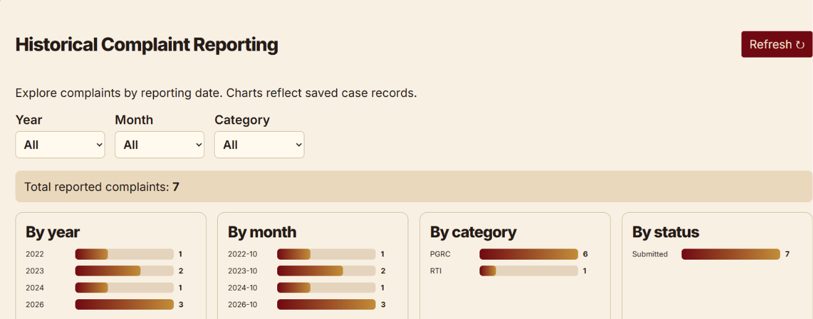

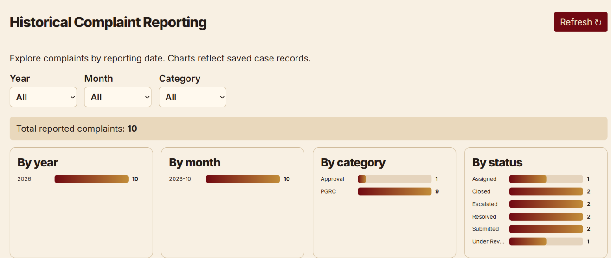


## ✦ Repository layout

```text
AICTE-Grievance-Intelligence-System/
├── assets/
│   ├── banner.png
│   └── system-architecture.png
├── docs/
│   └── index.html               # GitHub Pages interactive architecture
├── frontend/                 # React + Vite application
├── backend/                  # FastAPI routes and case workflows
├── ai_engine/                # Similarity and overlap checks
├── tests/
├── requirements.txt
├── README.md
└── LICENSE
```


The first Sentence Transformers model load may require internet access to download model weights. Subsequent local inference can run offline when files are cached.

## ✦ Details

| Item | Details |
|:---|:---|

| **Interactive architecture** | [Open HTML source](docs/index.html) · [Live interactive page](https://YOUR_USERNAME.github.io/YOUR_REPOSITORY/) |
| **Team** |CYBRIXX |
| **SIH problem statement** | SIH26264 |


## ✦ Responsible use

Student grievances may contain sensitive personal information. Do not commit real complaints, credentials, or private institution records to a public repository. Use synthetic demo records and enforce permissions in the backend. Model scores are advisory; accuracy and thresholds should be evaluated before operational use.

---

<div align="center">
  <b>AICTE GRIEVANCE INTELLIGENCE SYSTEM</b><br/>
  <sub>Institutional visibility · Connected workflows · Responsible AI</sub><br/><br/>
  <sub>Smart India Hackathon 2026 · Educational prototype · Not affiliated with or endorsed by AICTE</sub>
</div>
