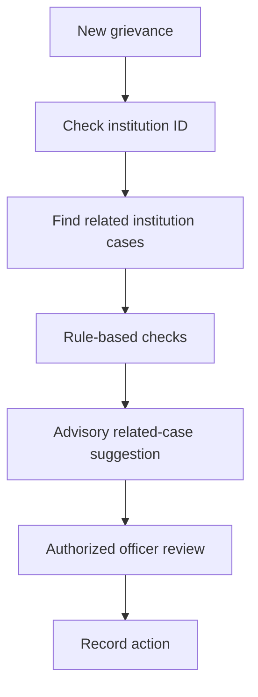

<h1>Integrated Institutional Grievance Intelligence, Monitoring and Cross-Bureau Coordination System</h1>

**Smart India Hackathon 2026 · AICTE · Prototype**

*One institution. One connected grievance history. Better-informed coordination.*

## ✦ The idea

Institutional complaints are often easier to understand **together** than as isolated tickets. This proposed platform connects student grievances, institution identities, officer assignments, and bureau workflows in one institution-centric workspace.

Complaints can be linked using an **AICTE Permanent ID**; official verification is a planned integration. Officers can explore complaint history, inspect potential duplicates, and review advisory coordination alerts across the **Regulation Bureau (RB)** and **Public Grievance Redressal Cell (PGRC)**.

> **Project scope:** Educational SIH prototype, not an official AICTE service. AI suggestions require officer review and do not automatically merge, escalate, or resolve cases.

## ✦ At a glance

| Institution intelligence | Cross-bureau coordination | Human-in-the-loop AI |
|:---|:---|:---|
| One institution profile links cases, statuses, and officers. | Potential RB–PGRC overlap alerts highlight coordination needs. | Advisory category and related-case suggestions support officer review. |

## ✦ System architecture

**[Open interactive technology architecture](https://elaki-ya.github.io/Integrated-Institutional-Grievance-Intelligence-Monitoring-and-Cross-Bureau-Coordination-System/)**

The live link requires **GitHub Settings → Pages → Deploy from a branch → main → /docs** and an actual `docs/index.html` file committed to the `main` branch. You can also [view the HTML source](docs/index.html). GitHub README pages cannot execute interactive JavaScript.

<b>Architecture explanation</b>

1. **Users:** Students, officers, institutions, and administrators.
2. **Frontend:** React + Vite for forms, dashboards, case views, and graphs.
3. **Backend:** Python + FastAPI for endpoints and workflows.
4. **Intelligence & data:** SQLite and rule-based complaint checks; SBERT and TF-IDF are proposed enhancements.
5. **Outputs:** Officer workspace, institution profiles, relationship graphs, reports, and alerts.

## ✦ Platform modules

<b>01 — Student grievance portal</b>

Students select an institution, submit grievance details, and track case status.

<b>02 — Officer dashboard & case workspace</b>

Authorized officers inspect cases, assignments, remarks, status changes, and action history.

<b>03 — Institution intelligence profile</b>

Institution records connect complaint history, categories, bureau assignments, and officers.

<b>04 — RB–PGRC coordination alerts</b>

Potentially overlapping active cases can be flagged for authorized officer review.

<b>05 — Relationship graph & reporting</b>

Visual relationships link institutions, complaints, bureaus, and officers; reporting summarizes case history.

## ✦ AI-assisted intelligence

Current prototype screenshots show **rule-based category suggestions** and **potential duplicate detection**. The following NLP methods are **proposed enhancements**, not verified deployed models.

| Model / method | Intended role |
|:---|:---|
| Sentence-BERT (`all-MiniLM-L6-v2`) | Semantic complaint embeddings |
| TF-IDF | Keyword similarity baseline |
| Cosine similarity | Similarity scoring |
| Python rules | Institution, status, and bureau overlap checks |
| SLA rules | Deadline monitoring |

## ✦ Technology stack

| Layer | Technology | Purpose |
|:---|:---|:---|
| Frontend | React + Vite | Interactive web interface |
| Backend | Python + FastAPI | REST endpoints and workflows |
| Database | SQLite | Prototype records |
| Current intelligence | Python rules | Advisory category and case checks |
| Proposed NLP | Sentence Transformers, scikit-learn | Semantic and keyword similarity |
| Access | Role-based permissions | Authorized workflows |

## ✦ Demo journeys

**Complaint to officer review:** Student submits a grievance → case is stored → related-case checks run → officer reviews and records actions.

**Potential cross-bureau overlap:** Related RB and PGRC complaints → advisory flag → officer verification → documented coordination decision.

## Application screenshots

**[Click to explore all 10 application screenshots](https://elaki-ya.github.io/Integrated-Institutional-Grievance-Intelligence-Monitoring-and-Cross-Bureau-Coordination-System/gallery.html)**

One compact icon · Browse with arrows · Click to enlarge · Return to the README

<h2>✦ Repository layout</h2>

The documentation and interactive architecture files are organized as follows:

<pre lang="text">repository/
├── README.md
├── assets/
│   ├── banner.png
│   ├── system-architecture.png
│   ├── gallery-stack.svg
│   └── screenshots/
│       ├── ai-case-intelligence.png
│       ├── case-submission.png
│       ├── historical-reporting.png
│       ├── historical-reporting-status.png
│       ├── institution-profile.png
│       ├── officer-case-assignment.png
│       ├── officer-chat.png
│       ├── officer-chat-attachment.png
│       ├── relationship-graph-case.png
│       └── relationship-graph-institution.png
└── docs/
    ├── index.html
    ├── interactive-architecture.html
    └── gallery.html</pre>

<strong>Note:</strong> The tree shows documentation files only. Add <code>frontend/</code> and <code>backend/</code> when they are present in your repository.

<h2>✦ Project details</h2>

<table>
<thead><tr><th align="left">Item</th><th align="left">Details</th></tr></thead>
<tbody>
<tr><td>Team</td><td><strong>CYBRIXX</strong></td></tr>
<tr><td>Hackathon</td><td>Smart India Hackathon 2026</td></tr>
<tr><td>Problem statement</td><td><strong>SIH26264</strong></td></tr>
<tr><td>Screenshot gallery</td><td><a href="docs/gallery.html">View gallery HTML source</a></td></tr>
<tr><td>Architecture source</td><td><a href="docs/index.html">View HTML file</a></td></tr>
<tr><td>Live architecture</td><td><a href="https://elaki-ya.github.io/Integrated-Institutional-Grievance-Intelligence-Monitoring-and-Cross-Bureau-Coordination-System/">Open GitHub Pages</a></td></tr>
<tr><td>Repository</td><td><a href="https://github.com/ELaKI-YA/Integrated-Institutional-Grievance-Intelligence-Monitoring-and-Cross-Bureau-Coordination-System">View GitHub repository</a></td></tr>
</tbody>
</table>

## ✦ Responsible use

Student grievances may contain sensitive personal information. Do not commit real complaints, credentials, or private institution records to a public repository. Use synthetic records and enforce permissions on the backend. AI suggestions are advisory and require human review.

---

**AICTE GRIEVANCE INTELLIGENCE SYSTEM**

*Institutional visibility · Connected workflows · Responsible AI*

Smart India Hackathon 2026 · Educational prototype · Not affiliated with or endorsed by AICTE

