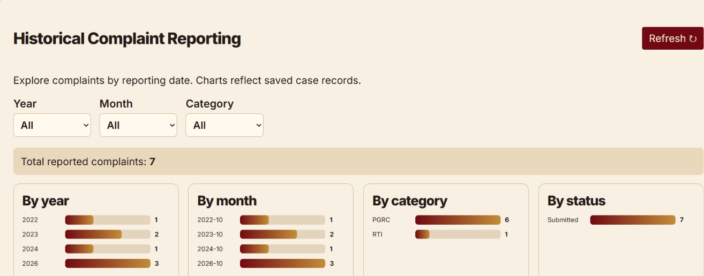

<div align="center">
  
</div>

# AICTE Integrated Institutional Grievance Intelligence, Monitoring & Cross-Bureau Coordination System

<div align="center">

**Every Case Deserves to Be Heard**

*Smart India Hackathon 2026 — Educational Prototype*

**React · Vite · Python · FastAPI · SQLite**

</div>

## Overview

An educational prototype for submitting, monitoring, assigning and investigating institutional grievances. It combines a complaint management workflow with officer collaboration, historical reporting and an interactive connected-case relationship graph.

> This is an educational prototype, not an officially deployed AICTE service. Some capabilities described below are proposed enhancements and are not guaranteed to be implemented in the current source code.

## Problem and Solution

Institutional grievances about certificates, fees, salaries and approvals can be difficult to coordinate across offices. Similar issues from the same institution may be overlooked, and officers may lack a clear picture of related cases. This project aims to centralize grievance records, help officers investigate connections and support cross-bureau collaboration.

## Key Features

- **Complaint management:** Submit and track cases with institution, category, description and status information.
- **Officer case workspace:** View incoming complaints, assign officers and review case information.
- **AI-assisted case intelligence:** Organize complaint categories and identify potentially related institutional issues.
- **Connected Case Graph:** Explore institutions, categories, complaints and officer relationships through circular nodes.
- **Historical Complaint Reporting:** Filter and review records by year, month, category and status.
- **Officer Chat:** Support investigation-related communication and coordination.
- **Cross-bureau workflow:** Connect relevant officers and bureaus around cases.

## Updated Interface Screenshots

### Cases Dashboard
Incoming grievances, institution names, complaint identifiers and current statuses.


### Historical Complaint Reporting
Year, month and category filters, complaint totals and reporting charts.



### Connected Case Graph
Relationship network of institutions, categories, individual complaints and officers, alongside an institution information panel.


## Animated Features

### 1. Officer Private Chat


### 2. Case Details and AI Case Intelligence


### 3. Historical Complaint Reporting


### 4. Connected Case Graph and Officer Workspace


### 5. Case Assignment and Officer Collaboration


### 6. Complaint Relationship Network


*GIFs are compressed recordings of the prototype interface. Some small text may be less readable in the animations.*

## Connected Case Intelligence Graph

The graph visualizes relationships between **institutions**, **complaint categories**, **individual grievances**, and **officers**. The proposed extended graph also links **students**, **dates**, and **AICTE bureaus** where permissions allow.

| Node type | Color |
|---|---|
| Institution | `#123C60` |
| Student | `#2D7668` |
| Officer | `#486DAD` |
| Complaint | `#6C559A` |
| Submission date | `#A47732` |
| Bureau | `#467D89` |
| High-severity alert | `#C62828` |

## Planned AI Severity Alert

The intended severity rule is triggered when **more than five complaints** concern **the same institution and the same or a sufficiently similar issue**.

1. A student submits a complaint through the complaint interface.
2. The backend saves it as an independent case record.
3. Similarity logic checks institution ID and issue similarity.
4. On the **sixth matching complaint**, a high-severity alert is created.
5. A **small blinking red circle** appears on the Officer Dashboard.
6. Clicking the circle opens **Case Details** with all matching complaints.
7. A connected graph panel slides in from the right, showing linked entities and cases.
8. Acknowledging the alert stops blinking while preserving alert history.

**Implementation status:** This end-to-end automatic workflow is a planned feature; verify it against the deployed application before claiming it is complete.

## Officer Case Management and Chat

Case details are designed to include case ID, institution, complaint description, category, submission date, status, assigned officer, bureau, related complaints, attachments and investigation history.

The proposed officer communication workflow is:

`Officer Dashboard → Case Details → Select Officer → Case-Linked Chat → Investigation Update`

Planned chat capabilities include private messaging, cross-bureau coordination, case-linked conversations, timestamps, message history, notifications and authorized document sharing. Feature availability depends on the application build.

## Historical Complaint Reporting

The reporting interface summarizes saved complaints using **year**, **month**, **category**, and **status** views. Filters help officers explore grievance patterns over time. Counts shown in screenshots are demonstration data, not live institutional statistics.

## Technology Stack

| Layer | Technology |
|---|---|
| Frontend | React + Vite |
| Styling | CSS |
| Backend | Python + FastAPI |
| Database | SQLite |
| Machine Learning (planned) | Python, scikit-learn; TF-IDF and cosine similarity for NLP-based matching |
| NLP applications (planned) | Complaint classification, semantic similarity, related-case grouping |
| Communication | REST APIs |
| Intelligence | Rule-based classification / similarity logic; advanced semantic matching proposed |
| Visualization | Interactive relationship graph |

ML technologies above are proposed approaches; confirm dependencies and trained models before claiming implementation. The six-complaint escalation threshold is a rule-based trigger.

## Architecture

```text
Student / Officer Interfaces
           |
       React + Vite
           |
         REST API
           |
      FastAPI Backend
           |
  +--------+---------+
  |        |         |
Cases  Intelligence  Officer Workspace
  |        |         |
  +--------+---------+
           |
       SQLite DB
           |
    Reports and Graph
```

## Grievance Workflow

```text
Submit Complaint
      ↓
Save Case Record
      ↓
Classify / Check Similarity
      ↓
Officer Dashboard
      ↓
Assign and Investigate
      ↓
Review Related Cases / Coordinate
      ↓
Update Status / Resolve
```

## Installation and Local Setup

**Prerequisites:** Python 3, Node.js and npm.

The following commands assume `backend/` and `frontend/` are inside the project root. This README/media ZIP does **not** contain those application directories; obtain the runnable project separately.

### Backend

```powershell
cd backend
python -m pip install -r requirements.txt
python -m uvicorn main:app --reload --port 8001
```

Backend: `http://localhost:8001`  
FastAPI docs (if enabled): `http://localhost:8001/docs`

### Frontend (new terminal, from project root)

```powershell
cd frontend
npm install
npm run dev
```

Frontend (default): `http://localhost:5173` — use the address shown by Vite if it selects another port.

## Interface Theme

| Element | Color |
|---|---|
| Dashboard background | Sage Grey `#9AAEAB` |
| Text and icons | Deep Midnight Navy `#060927` |
| Severity alert | Red `#C62828` |

The design uses professional vector icons, consistent navigation and accessible information hierarchy. The precise font family for the requested vintage-style labels is not yet confirmed.

## Future Enhancements

- Semantic issue similarity detection and explainable severity classification
- Real-time notifications and persistent alert acknowledgment
- Expanded student, officer, bureau and date relationship nodes
- Richer case-linked officer chat and attachment management
- Role-based access control and audit trails
- Enhanced analytics and investigation summaries

## Project Purpose

Built as a **Smart India Hackathon 2026 educational prototype** to demonstrate a more transparent, coordinated and intelligence-assisted approach to institutional grievance redressal.

---

<div align="center"><strong>Every Case Deserves to Be Heard.</strong></div>
